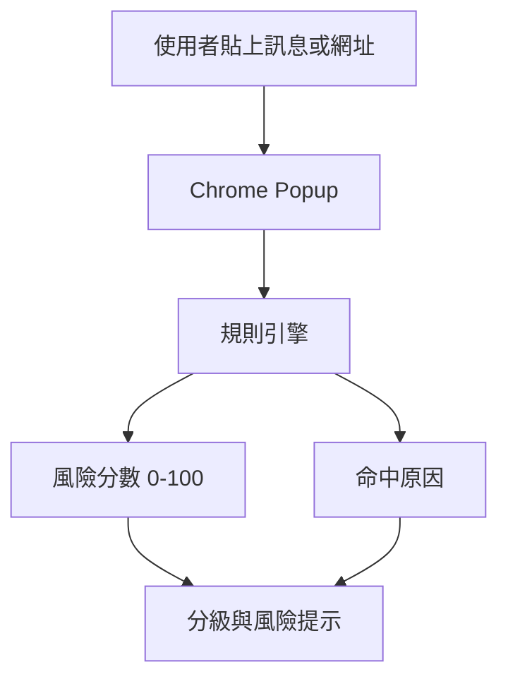

# ScamLens — 可解釋的詐騙訊息風險檢測器

## 1. 專案定位

ScamLens 是以 Chrome Extension Manifest V3 製作的本機端詐騙與釣魚風險提示原型。外掛會在可掃描的網頁載入後，分析網址特徵與頁面可見內容；使用者也可以手動貼上訊息進行分析。系統根據可解釋的風險規則輸出 0–100 分風險值與命中原因。此版本不宣稱能判定詐騙，而是協助使用者辨識常見紅旗並回到官方管道查證。

## 2. MVP 功能

- 貼上文字／網址進行分析
- 網頁載入後自動分析網址與頁面訊號
- 偵測 Punycode、混合文字系統與常見同形字風險
- 偵測敏感表單、急迫 CTA、倒數字樣與疑似一頁式導流特徵
- 在頁面頂端顯示非阻擋式警告
- 偵測急迫催促、金流要求、敏感資料索取、可疑導流、高報酬話術、私下聯絡等訊號
- 顯示風險分數、低／中／高風險分級與可讀原因
- 本機執行：不將訊息送至任何伺服器、不保存輸入內容

## 3. 架構

### 檔案導覽

| 檔案 | 角色 |
|---|---|
| `manifest.json` | Chrome Extension Manifest V3 設定與 popup 入口 |
| `popup.html` | 輸入區、操作按鈕與結果區的語意化介面 |
| `popup.css` | 深色、窄版 popup 的視覺樣式與風險色彩 |
| `popup.js` | popup 互動、目前網頁結果與手動分析 |
| `background.js` | 背景分頁事件、網址與頁面結果整合 |
| `content.js` | 讀取頁面可見文字與表單特徵、顯示頁面警告 |
| `analyzer.js` | 共用的網址、文字、頁面特徵規則引擎 |

資料流是：分頁載入 → `content.js` 收集頁面特徵 → `background.js` 整合網址與內容 → `analyzer.js` 計算分數 → popup 與頁面警告顯示結果。分析仍在本機完成；目前沒有外部 API、原始封包攔截或資料庫。Chrome 外掛可觀察的請求 metadata 與完整封包是不同層級，本版本先不宣稱具備封包監控能力。

## 4. 偵測規則與可解釋性

| 訊號 | 例子 | 分數 |
|---|---|---:|
| 緊急壓力 | 立即、帳戶凍結、限時 | 20 |
| 金流請求 | 匯款、保證金、付款 | 20 |
| 敏感資料 | OTP、密碼、身分證、信用卡 | 25 |
| 可疑導流 | 短網址、私訊導流、`.xyz` | 15 |
| 利誘話術 | 中獎、高報酬、穩賺 | 15 |
| 私下轉移 | 不要告訴、加好友 | 10 |

總分取 100 為上限；0–29 為低風險／資訊不足、30–59 為中風險、60 以上為高風險。規則引擎的優點是每一筆判斷都可解釋；限制是可能誤判，且不能取代查證或警方／平台處理。
